# Pima County S.T.O.P. Initiative (Stop Theft of Property)

A free, voluntary safeguard against **deed fraud and title theft**. A property owner
registers a digital signing key with the County Recorder once. After that, any deed
filed against the parcel has to carry that key's signature. A forged deed without it
is held for investigation instead of being recorded.

This repository is the **website that makes it work**: owners create keys, register
them and sign documents, and Recorder staff check filings. It is a single HTML file
that runs entirely in the browser, works offline, and **stores and sends nothing**.

**Try it: https://pimastopinitiative.jasonajensen.workers.dev/**

> **Status: proposed.** The program has not been adopted by Pima County. Every page
> and PDF says so until the county adopts it (see [Rebranding](#rebranding-for-another-jurisdiction)).

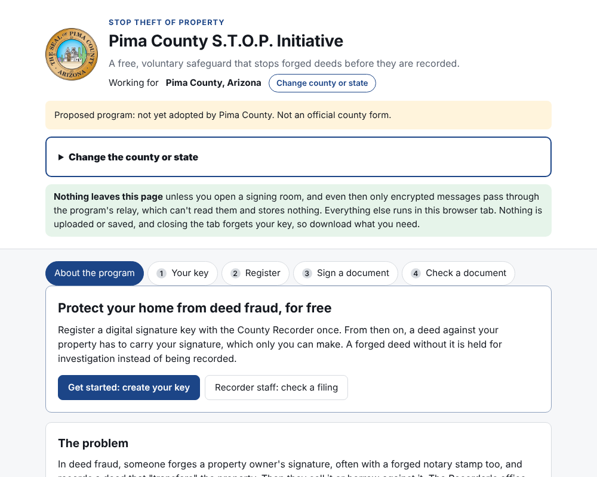

## Contents

- [The problem it solves](#the-problem-it-solves)
- [Features](#features)
- [How to use it](#how-to-use-it): [owners](#for-owners) and [Recorder staff](#for-recorder-staff)
- [What the printed documents look like](#what-the-printed-documents-look-like)
- [Security model and limits](#security-model-and-limits)
- [Rebranding for another jurisdiction](#rebranding-for-another-jurisdiction)
- [Running, hosting and development](#running-hosting-and-development)
- [Download and verify](#download-and-verify)
- [Changelog](CHANGELOG.md) and [License](#license)

## The problem it solves

In deed fraud, someone forges an owner's signature, often with a forged notary stamp
too, records a deed, and then sells or borrows against a property they don't own.
Once recorded, the transfer can't simply be undone: the real owner has to bring a
quiet title action in court, which is slow and expensive.

With S.T.O.P., the owner's **digital signature** (OpenPGP, an open standard used for
decades) must appear on any deed for a registered parcel. Only the holder of the
private key and its passphrase can make it. It prints on paper as QR codes that carry
the signature **and the exact text that was signed**, so the Recorder can check a
paper filing by scanning it. The existing paper process is unchanged; the ink
signatures and notarizations are still required. The digital signature is an extra
layer on equal footing with them.

## Features

**For owners**
- **Keys that say who signs with them**: an individual; a **group** (one key, every
  named person signs, e.g. a married couple, with a clear warning that a shared key
  can't prevent fraud between members); or a **position** in a business, trust or
  other entity (e.g. the Secretary of an LLC), naming its current holder.
- **The private key is a PDF**: print it for a safe, keep the file on a USB drive.
  It loads back from the PDF, a scan, or a **phone photo** of the printed page.
- **Registration forms, one per parcel**, listing every key for the parcel (all must
  sign), with a signature and identity-verification section for every signer: notary
  plus law enforcement officer for individuals, notary plus a business authority for
  position holders.
- **Proof of key possession**: every listed key digitally signs the registration
  itself, on one computer or each on their own.
- **Position holder updates**: when a position changes hands, the new holder signs a
  short update with the same key, notarized, filed with the registration.
- **Document templates**: warranty, quitclaim and beneficiary deeds (from Arizona's
  statutory short forms), plus a lease, an offer to sell or acceptance, a statement of
  ownership, and an authorization, or blank. Signature lines and a notary
  acknowledgment for every signer are generated from the registration.
- **Sign a file**: a PDF, Word (.docx), OpenDocument (.odt) or text file, one or
  more images, or a scanned PDF. It is recreated as a printable package (a cover page
  with the signature codes, the file's pages each stamped with the document ID and
  page number, and a signatures page) and that recreation is what's signed, so it
  can be checked from paper. Images and scans are signed with the signer's written
  description of them.
- **Binary file signature** (advanced): signs a file's exact bytes, for files sent
  directly to a tenant, buyer or bank. Not for recording: the Recorder takes paper.
- **Several owners, one document**: owners sign the same text on one computer, or
  pass the partly signed PDF along ("Sign exactly as others"). The text locks after
  the first signature.
- **Protection passes with a sale**: a warranty or quitclaim deed can name the
  buyers' signing keys (any number). They are part of the signed deed, and the deed
  PDF carries them as the parcel's next registration: once it is recorded, load the
  deed in place of a registration form. No new registration or identity check is
  needed; the sellers' registered keys handed protection to the buyers.
- **Lien holders**: a registration can be for a lien holder instead of an owner,
  naming the lien, so a forged **release of lien** is held like a forged deed.
- **Leaving the program**: a deregistration document, signed with every registered
  key, takes the parcel out.

**For the Recorder, and anyone given a signed document**
- **Check a document** from the signed PDF, the Recorder's own scan, a phone photo, or
  a handheld scanner. Several copies can be checked together; all must carry the same
  text.
- The check requires **every registered key** to have signed **the same text**, **no
  unregistered key**, and a **fully
  proven registration**. If the text doesn't name the registered parcel, the result says
  it was signed by the owners but is **for third parties only, not for recording**.
  To file one, tick **Ready this document for parcel filing** before signing: a signed
  statement ties it to the parcel. The signed text is shown to compare with the paper.
- **Fast to check, even for long documents**: each page of codes carries a small
  PDF417 "code map" saying where every QR code is, so the reader cuts them out
  directly instead of searching the page (a 25-code scan checks in about 1.5 s).
- A printable **verification certificate** for the checker to sign and append to the
  filing.
- A **checked copy**: the checked file (PDF pages or images), every page stamped with
  the result, the date and the document ID.
- Tenants, buyers and banks can check a lease, offer or statement against the owner's
  registration or public key card, and check binary-signed files.
- A **combined filing**: tick two boxes and download one PDF with the original
  document exactly as loaded, the checked copy, and the certificate, which lists the
  page ranges and each original's SHA-256 fingerprint.

**Built to be trusted**
- Runs entirely in the browser; a Content-Security-Policy blocks every network
  connection. No server, no accounts, nothing stored.
- Standard OpenPGP: every signature also verifies with stock GnuPG.
- One self-contained HTML file that works offline.
- Free and open source, with an express license grant for governments.
- **Any county or state**: pick any U.S. county from the list (Census Bureau, public
  domain); its recording office is filled in (County Recorder, County Clerk, Register of
  Deeds...). The program name, web address and logo can be changed too, for the session,
  from a settings file, or from the link.
- **Versioned**: the version, build date and changelog are in the page (About this
  software), with a link to download the tool itself.

## How to use it

Open the site (or the downloaded `index.html`) in Chrome, Edge, Safari or Firefox.
Opening it inside an email or chat preview may block downloads; open it directly.

### For owners

**1. Create your key.** Choose who signs with it, enter the name(s), and a passphrase.
Download the **private key PDF** and keep it safe; the site keeps nothing. Give
co-owners your **public key card** so they can list your key.

| Create a key | Your key |
|---|---|
| 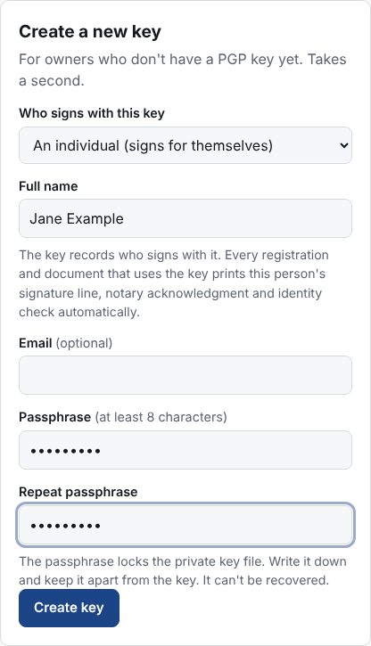 | 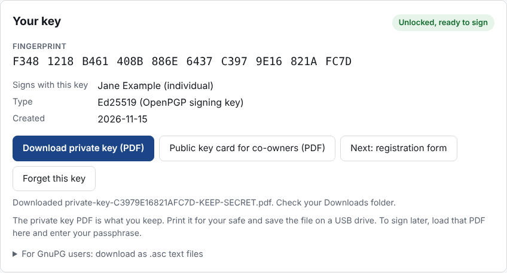 |

**2. Register.** Enter the parcel number(s) (one form per parcel) and add any other
keys for the parcels (optional: one key is enough for any owner). Choose **Sign the
registration with my key**. If there are other keys, each holder signs too, on the
same computer or by loading the partly signed PDF with **Continue a registration**.
Print the form; each signer signs in ink before a notary and has their identity
checked; file it with the Recorder.

| Registration form | Every key has signed |
|---|---|
| 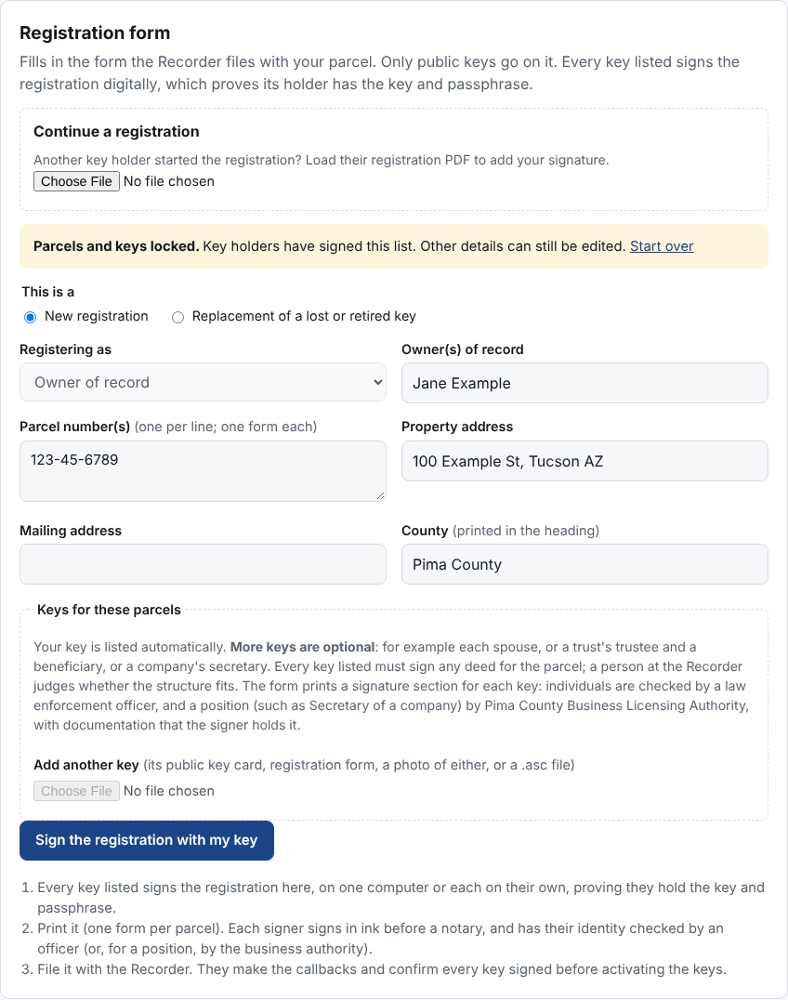 | 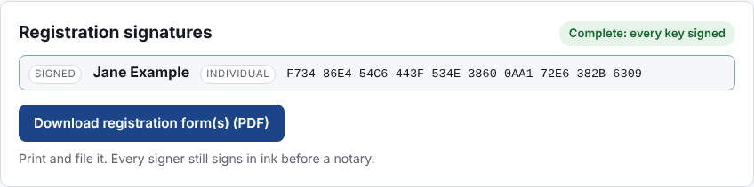 |

**3. Sign a document.** Load the parcel's registration, pick a template (or blank),
fill it in, and **Sign**. Co-owners add their signatures. Print the document: it has a
signature block and notary acknowledgment for every signer, and a final page of QR
codes. Sign in ink before a notary as usual.

| Writing a lease | Signed |
|---|---|
| 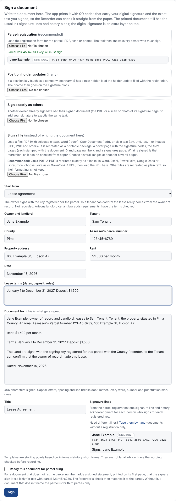 | 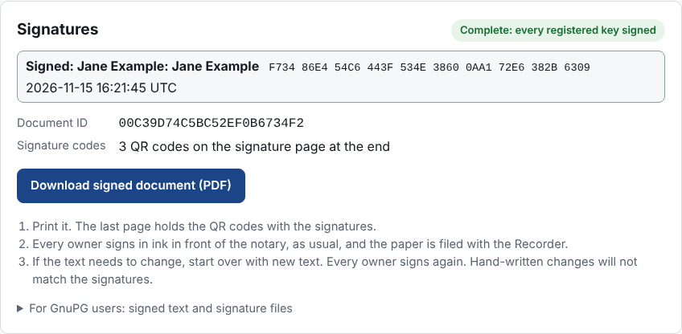 |

**Or sign a file.** Under **Sign a file**, load a PDF, Word or text file, or images.
Its text appears, locked, as what will be signed. For an image or a scan, write what
it shows (include the parcel number). Sign, and print the package: cover page, the
file's pages (each stamped "page i of n" with the document ID), and the signatures
page.

**Long documents.** There is no length limit. The signature carries the whole text
in its QR codes, so above 30,000 characters the Sign tab says how many codes and
printed pages it will take, and asks you to tick **Sign it anyway**.

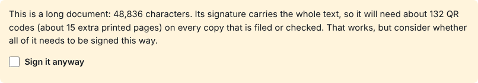

**Selling the property.** Pick the warranty or quitclaim deed and add each buyer's key
(their public key card, registration form, a photo, or a `.asc` file) under
**Buyers' signing keys**. The keys go into the deed text and onto a "registration by
sale" page in the PDF. Once the deed is recorded, it is the parcel's registration:
the buyers load it in place of a registration form to sign later documents. Before
that, **each buyer proves they hold their key**, just as every key holder signs a
registration form: they load the deed with **Sign exactly as others** (or use the same
computer), unlock their key, and choose **Prove my buyer key**.

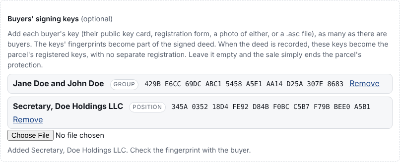

**Signing together, live.** Owners (and buyers) can sign the same document at the same
time, each on their own computer, on the program's own site (a saved copy can't): unlock
your key, turn on **Sign together** on the Sign tab, start a room and send the link. Everyone appears with the key they proved they
hold, and every signature shows up in every tab. The document is encrypted in each tab
with a key that is only in the link, so the program's relay can't read it, and nothing is
stored. It's off until you turn it on. The relay is the site's own Cloudflare Worker
([`worker/`](worker/README.md)), which also counts page loads, downloads and rooms by
country. On the web the page also asks each visitor whether it may count the visit with
Cloudflare Web Analytics (no cookies); it loads only if they allow it. Set your token in
`MASTER_ANALYTICS_TOKEN` (`src/brand.ts`).

**Lien holders** register the same way, choosing **Registering as: Lien holder** and
naming the lien. A release of that lien (the **Release of lien** template) is then
checked against the lien holder's registration. **Leaving the program**: the
**Deregistration** template, signed with every registered key and recorded.

**Binary file signature** (advanced, at the bottom of the Sign tab): for a file you
send to someone directly, not for recording. Download the `.sig` and the verification
page and send both with the file.

### For Recorder staff, tenants, buyers and banks

**Check a document**: load the parcel's registration (the form PDF, a scan or a photo),
then the filed document (or several copies), or scan its QR codes. The result is
**GOOD** (compare the signed text with the paper, then record as usual), **DOES NOT
VERIFY** (hold the filing; suspected forgery), or **NOT CHECKED YET** (codes missing).
Then print the **verification certificate**, sign it, and append it to the filing,
or download a **checked copy** of the file with every page stamped with the result.
A tenant, buyer or bank can load the owner's public key card instead of a
registration. For a binary-signed file, open **Check a binary-signed file** and load
the file with its `.sig` or verification page.

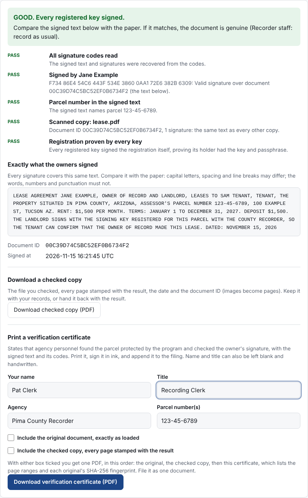

To file the check with the document, tick **Include the original document** and
**Include the checked copy** before downloading the certificate: one PDF with the
original, the stamped copy and the certificate, in that order.

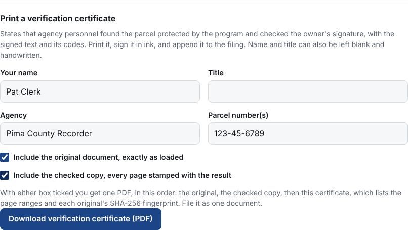

Anyone can also check a signature without this site, with GnuPG: save the signed text
(`.txt`) and signature (`.sig`) from the document, import the registered public keys,
and run `gpg --verify document.txt.sig document.txt`.

## What the printed documents look like

| Registration (page 1) | Signed lease (page 1) | Signature page | Verification certificate | Private key |
|---|---|---|---|---|
| 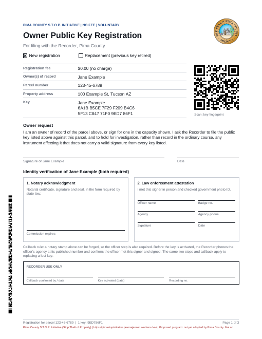 | 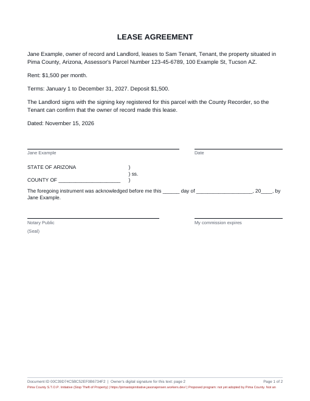 | 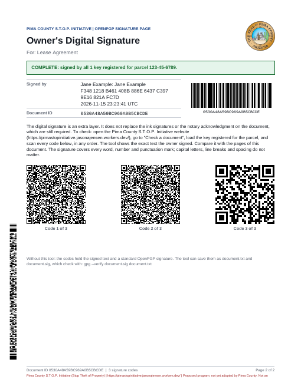 | 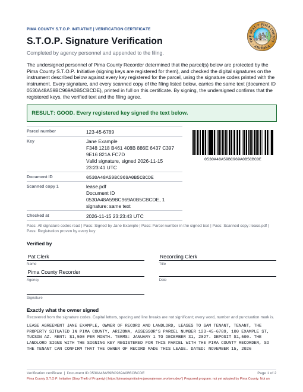 | 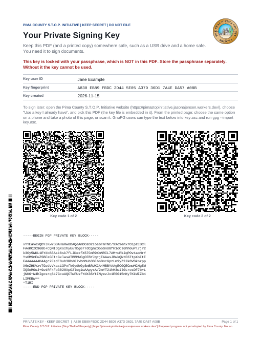 |

## Security model and limits

- **What it stops:** a forged deed on a registered parcel. The forger can copy a
  signature or a notary stamp, but cannot make the owner's digital signature without
  the private key **and** its passphrase. Altering any word or number after signing
  breaks the signature. A valid signature for one document or parcel can't be reused
  on another (the text, including the parcel number, is what's signed).
- **Registration** is the weak point any such system has, so it takes two independent
  identity checks (a notary and a law enforcement officer, or a business authority
  for entity positions), a Recorder callback to the verifying agency, and a digital
  signature from every listed key proving its holder has it.
- **It does not protect against** someone who has both the private key file and the
  passphrase; fraud between members of a **group key** (anyone in the group can make
  the digital signature); or collusion by the people verifying identity at
  registration. Keep the key and passphrase apart; use separate keys for the
  strongest protection.
- **Templates are starting points, not legal advice.** Have the wording checked.

## Rebranding for another jurisdiction

**Without changing any code**: click **Change county or state** in the page header
(or the seal), on any tab. Enter the county, state and a logo; the program name and
business verification office follow the county unless you type your own. Every page
and PDF uses them until the page is closed.

The settings can also be **given in the link**, so a county can hand out one address:

```
https://pimastopinitiative.jasonajensen.workers.dev/?county=Maricopa%20County&state=Arizona
```

Link settings: `name`, `expansion`, `county`, `state`, `url`, `authority`, and `seal`.
The seal must be the image itself as a `data:image/png;base64,...` (or `image/jpeg`)
address: the page never loads anything from another server, so a seal at a web
address is refused. **Copy a link with these settings** in the panel builds the link,
logo included. The panel's **Link settings (API) and link builder** section documents every
parameter and builds the link live.

**Rapid deployment for another county.** In the same section, **Download this county's
program** makes a zip: the whole program as one HTML file with that county's settings and
seal built in as its defaults, plus the Cloudflare Worker that serves it, relays its
signing rooms and counts its use, and a README (`npm install && npx wrangler deploy`).
Enter the copy's web address (printed on its PDFs). Tick "Sign together runs at this
address" to run signing rooms on its own Worker; otherwise, or whenever its relay can't
be reached, Sign together falls back to the master site,
https://pimastopinitiative.jasonajensen.workers.dev, in the same room. Each copy can
make the next county's copy.

Optionally, say **who is making the copy** (a person or office, a title or authority, and
where you'll post the statement) and tick **Sign the program file with my key** (unlock
your key first). You then get a **release statement** PDF to put on your website. It
gives the program file's SHA-256 (a file can't carry its own hash), the zip's, your key
fingerprint and your signature. Anyone can check their copy with `sha256sum`, with
`gpg --verify index.html.sig public/index.html`, or in the program's "Check a
binary-signed file" with just the file and the statement.

**State seals.** Choosing a county in another state shows that state's seal on the page
and the PDFs (Pima County keeps its own; an uploaded logo always wins). The 50 seals come
from Wikimedia Commons; their credits are in [SEALS.md](SEALS.md). Many states restrict
the use of their seal by law: get permission before any official use. **Save settings file** keeps them for next time. The "proposed program"
notice stays on.

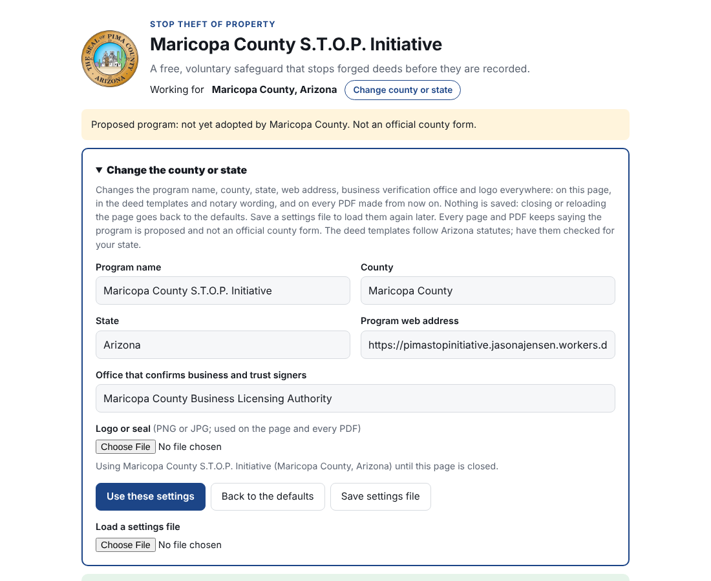

**For a county's own build**, everything specific to Pima County and Arizona is in a
few places:

1. **`src/brand.ts`**: program name and acronym, county, **state**, project web
   address (`projectUrl`, printed on every PDF), the office that verifies entity positions
   (`entityAuthority`), and the **proposed/adopted status**. While `status` is
   `'proposed'`, every page and PDF says the program has not been adopted. Change it
   to `'adopted'` only once the jurisdiction has adopted the program and approved use
   of its seal.
2. **The seal or logo**: embedded in `index.html` as base64 in ``.
   The comment above that tag explains how to replace it (Mac, Linux and Windows
   commands). The PDFs use the same image. Set `src=""` for no seal.
3. **Document templates**: `src/templates.ts`. The deed templates follow Arizona's
   statutory short forms (A.R.S. 33-402 and 33-405) and the lease note mentions
   Arizona landlord-tenant law; replace them with your state's forms. The state name
   in the text comes from `BRAND.state`.
4. **Notary acknowledgment wording**: `src/pdf.ts` (search for "acknowledged before
   me"). The venue uses `BRAND.state`; adjust the wording to your state's form.
5. **About page text**: the "About the program" section of `index.html`.

Then run `npm run build`; `dist/index.html` is the finished site.

## Running, hosting and development

- **Use it**: open `dist/index.html` in a browser, or host that single file on any
  web server or GitHub Pages. It needs no server-side code.
- **Develop**:

```sh
npm install
npm run dev        # local dev server
npm test           # unit, GnuPG interop, and printed-code scan tests
npm run typecheck
npm run build      # dist/index.html: one self-contained file that works offline
npm run proof      # build, then the full ownership chain in Chromium -> proof/<version>/
```

The scan tests need `pdftoppm` (poppler-utils), `zbarimg` (zbar-tools) and
ImageMagick `convert`; the interop tests need `gpg`. Each is skipped if missing.

**Layout**: `src/crypto.ts` (OpenPGP: keys, signing, registration proof, checks),
`src/pdf.ts` (every printed document), `src/qrscan.ts` (reading codes from PDFs,
scans and photos), `src/text.ts` (the canonical text that gets signed),
`src/templates.ts`, `src/brand.ts`, `src/main.ts` and `index.html` (the site).
`CLAUDE.md` holds the detailed project brief and the open questions.

## Download and verify

Each release also has a **build proof** in [`proof/`](proof/): the built file was run
through the full ownership chain (a registration, two sales with every form of the
Recorder's filing used as the next registration, and checks that must fail), and every
PDF it made is there with a `REPORT.md` naming the build's SHA-256.

The site's footer and its About tab have **Download this tool**, which saves the
whole program as one HTML file that works offline. To confirm a copy is the official
one, compare its SHA-256 fingerprint (`sha256sum file.html` on Linux,
`shasum -a 256 file.html` on a Mac, `Get-FileHash file.html` in Windows PowerShell)
with the table below. Versions are `v<major>.<minor>.<mmddyyyy>`; the date is the day
the version was released.

| Version | SHA-256 of the HTML file |
|---|---|
| v0.1.11152026 | `671fc55f164ef552cd5c47877d36f8f4bbd738de19306acf9295900778cdbf97` |

## License

Created by **Jason Adam Jensen** (project creator and grantor). Contact:
jasonajensen@gmail.com. Source: https://github.com/temperne/Open-Pgp-Registrar

This project uses the MIT License, with an express grant allowing states,
counties and other governments (including Pima County, the Pima County Recorder
and the State of Arizona, but not limited to them) to host the solution and
provide it to their residents. All warranties are disclaimed and no liability is
accepted. The full text is below and in [`LICENSE`](LICENSE).

```
Pima County S.T.O.P. Initiative (Stop Theft of Property) - Open PGP Registrar
MIT License, with an express grant for government use

Copyright (c) 2026 Jason Adam Jensen

Project creator and grantor: Jason Adam Jensen
Contact: jasonajensen@gmail.com
Source code: https://github.com/temperne/Open-Pgp-Registrar

Permission is hereby granted, free of charge, to any person or organization
obtaining a copy of this software and associated documentation files (the
"Software"), to deal in the Software without restriction, including without
limitation the rights to use, copy, modify, merge, publish, distribute,
sublicense, host, operate and/or sell copies of the Software, and to permit
persons to whom the Software is furnished to do so, subject to the following
condition:

The above copyright notice and this permission notice shall be included in all
copies or substantial portions of the Software.

GOVERNMENT USE. Without limiting the grant above, permission is expressly
granted to every state, county, city, town, municipality, tribal government,
special district, and other government body or agency, and to any contractor
or vendor acting on its behalf, including without limitation Pima County,
Arizona, the Pima County Recorder, and the State of Arizona, to use, copy,
modify, rebrand, host and operate the Software, and to provide it to the public
and to their residents, with or without charge, for the purpose of offering
this solution or for any other purpose. No fee, registration, notice to the
grantor, or further permission is required.

NO WARRANTY. THE SOFTWARE IS PROVIDED "AS IS", WITHOUT WARRANTY OF ANY KIND,
EXPRESS OR IMPLIED, INCLUDING BUT NOT LIMITED TO THE WARRANTIES OF
MERCHANTABILITY, FITNESS FOR A PARTICULAR PURPOSE, TITLE AND NON-INFRINGEMENT,
ALL OF WHICH ARE EXPRESSLY DISCLAIMED. THE SOFTWARE, INCLUDING ITS DOCUMENT
TEMPLATES AND DOCUMENTATION, IS NOT LEGAL ADVICE.

NO LIABILITY. IN NO EVENT SHALL THE AUTHOR, GRANTOR OR COPYRIGHT HOLDER BE
LIABLE FOR ANY CLAIM, DAMAGES, LOSS OF PROPERTY OR TITLE, OR OTHER LIABILITY,
WHETHER IN AN ACTION OF CONTRACT, TORT OR OTHERWISE, ARISING FROM, OUT OF OR IN
CONNECTION WITH THE SOFTWARE OR THE USE OR OTHER DEALINGS IN THE SOFTWARE.
ANYONE WHO USES, HOSTS OR PROVIDES THE SOFTWARE DOES SO AT THEIR OWN RISK.

THIRD-PARTY COMPONENTS. The built application includes the following libraries,
each under its own license, which continues to apply to that library:
  - OpenPGP.js: GNU LGPL-3.0-or-later (https://github.com/openpgpjs/openpgpjs).
    Its source is available there, and this project can be rebuilt with a
    modified copy of it from the source code above.
  - PDF.js (pdfjs-dist): Apache-2.0 (https://github.com/mozilla/pdf.js)
  - jsQR: Apache-2.0 (https://github.com/cozmo/jsQR)
  - pdf-lib: MIT (https://github.com/Hopding/pdf-lib)
  - node-qrcode: MIT (https://github.com/soldair/node-qrcode)
  - JsBarcode: MIT (https://github.com/lindell/JsBarcode)
  - bwip-js: MIT (https://github.com/metafloor/bwip-js)
  - ZXing for JS (@zxing/library): Apache-2.0 (https://github.com/zxing-js/library)
  - County names: U.S. Census Bureau, 2020 FIPS county codes, a U.S. government work
    in the public domain (https://www2.census.gov/geo/docs/reference/codes2020/)
  - State seals: Wikimedia Commons, Category: SVG state seals of the United States
    (https://commons.wikimedia.org/wiki/Category:SVG_state_seals_of_the_United_States).
    49 are public domain; Maryland's is CC BY-SA 4.0 and stays under that license.
    Each file's author and license are in SEALS.md and on the page (About this
    software). Many are insignia whose use is restricted by state law.
```
